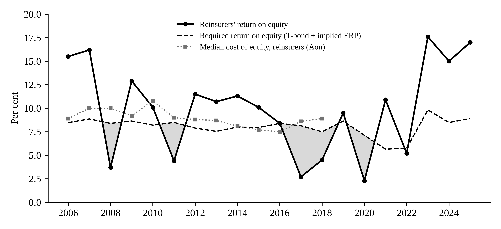

# Turbulent Arbitrage in Reinsurance: Regulating Capital and the Cycle

Data behind the figures of

> Aslan, I. (2026). Turbulent arbitrage in reinsurance: Regulating capital and the cycle. Working paper. [Abstract and PDF](https://ilkeraslan.github.io/papers/turbulent-arbitrage-in-reinsurance.html)

The paper reads the reinsurance underwriting cycle through Anwar Shaikh's theory of real competition. The price of a layer is regulated by the lowest-cost reproducible form of risk capital. Sector data for 2006–2025 and firm data for reinsurers filing with the US Securities and Exchange Commission show returns on equity gravitating around market-implied required returns, while net capital flows follow return shortfalls.

## Files

| Path | Content |
|---|---|
| `data/figure2_sector_returns.csv` | Figure 2, 2006–2025, in per cent: return on equity of the reinsurer composite tracked by Aon (`roe`), market-implied required return (`k_req`: ten-year US Treasury yield plus the implied equity risk premium, both at the start of the year) and the median cost of equity of the composite's members as estimated by Aon, available to 2018 (`coe_aon`) |
| `data/figure3a_firm_roe.csv` | Figure 3(a), 2009–2025, in per cent: return on average shareholders' equity of each firm of the core sample, by ticker, the median firm and the market-implied required return |
| `data/figure3b_interquartile_range.csv` | Figure 3(b): interquartile range of the firms' returns in each year, in percentage points |
| `figures/` | Figures 1 to 3 as PDF and PNG. Figure 1 is a numerical illustration with the parameters given in its notes |

This repository holds the data of the figures. The code is available from the author.

## Sources

- Aon, *Aon's Reinsurance Aggregate: Results for the Year to 31 December 2018* (2019); *Snapshot Guide to the Reinsurance Renewal* (September 2025); *Reinsurance Market Dynamics: April 2026 Renewal* (2026).
- Damodaran, A., "Historical implied equity risk premiums", updated January 2026, [pages.stern.nyu.edu/~adamodar](https://pages.stern.nyu.edu/~adamodar/New_Home_Page/datafile/histimpl.html).
- US Securities and Exchange Commission, EDGAR XBRL company concept data and annual reports on Forms 10-K and 20-F, accessed November 2026.

## Citation

Please cite the paper. GitHub's "Cite this repository" button gives the reference in APA and BibTeX formats.

## Licence

The data are compiled from the public sources listed above and may be reused with a reference to the paper (CC BY 4.0, see `LICENSE`).

## Author

Ilker Aslan, Lecturer, Kalaidos University of Applied Sciences, Zürich
[ORCID 0000-0001-9241-9420](https://orcid.org/0000-0001-9241-9420) · [ilkeraslan.github.io](https://ilkeraslan.github.io)
